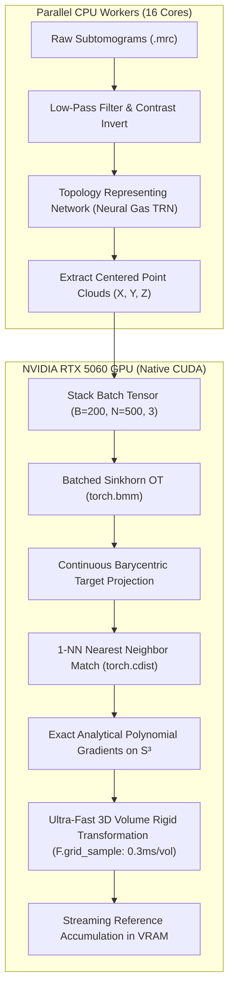

# Project Context & Agent Guide: Subtomogram Alignment & Averaging

Welcome to `subtmgr-align`. This document is the primary repository context and technical reference for AI agents and human contributors working on this project.

---

## 1. Problem Overview

**Cryo-Electron Tomography (Cryo-ET)** enables 3D visualization of cellular environments at nanometer resolution. However, cryo-ET data suffers from:
1. **Extremely Low Signal-to-Noise Ratio (SNR)** due to strict electron dose limits to prevent radiation damage.
2. **Missing Wedge Artifacts** caused by the physical tilt limitations of the microscope goniometer (typically $\pm 60^\circ$).

### Goal: Subtomogram Averaging (STA)
To achieve near-atomic structural resolution, hundreds to thousands of 3D sub-volumes (subtomograms) containing copies of the target macromolecule (e.g., GroEL chaperonin) must be **rigidly aligned in 3D (3D rotation + translation)** and averaged.

---

## 2. Active Development Focus & Implemented Approaches

> [!IMPORTANT]
> **Active Working Branch**: All current and upcoming development takes place on the **`dev` branch**. Previous experiments on $C_6$ multi-hypothesis (`feature/c6-multihypothesis`) have been concluded/deprecated.
>
> **Core Active Method**: **AlignOT SGD / Barycentric 1-NN SGD** with Native PyTorch GPU acceleration. All upcoming experiments build directly upon this GPU foundation.
>
> **Primary Evaluation Metric**: **Gold-Standard Even/Odd Half-Set FSC** (dividing the 200 particles into independent even and odd halves of 100 particles each, performing iterative alignment and averaging on both independently, and computing the FSC resolution at $\text{FSC} = 0.143$).

### Repository Structure
```
subtmgr-align/
├── alignOT/        # Entropic Optimal Transport (Sinkhorn) + Barycentric 1-NN SGD on S³ (GPU-Accelerated)
├── EMPOT/          # Unbalanced Gromov-Wasserstein (UGW) + Weighted Kabsch SVD (Historical OT Baseline)
├── eman2_baseline/ # Classical missing-wedge-aware STA baseline reference
├── Data/           # Subtomogram datasets (0.1/Cluster_0/*.mrc) & ground truth reference (0.mrc)
├── scripts/        # Production runner and FSC evaluation scripts
├── temp/           # Temporary outputs and ChimeraX-ready inverted maps
└── .agents/        # Custom workspace skills (invert-mrc-density, etc.)
```

### Approach: AlignOT (Entropic OT + Barycentric 1-NN SGD on S³)
- **Concept**: Formulates 3D rotational alignment directly on the unit quaternion manifold $S^3$.
- **Barycentric 1-NN SGD**:
  1. Computes Sinkhorn Optimal Transport plan $T \in \mathbb{R}^{M \times N}$ with entropic regularization $\epsilon = 100$.
  2. Projects source points to continuous barycentric target coordinates: $\mathbf{y}_{\text{bar}} = \sum_j \frac{T_{ij}}{\sum_k T_{ik}} \mathbf{x}_{\text{ref}}[j]$.
  3. Matches to the 1-Nearest Neighbor in the reference cloud.
  4. Optimizes rotation quaternion $q \in S^3$ via tangent-space projected Stochastic Gradient Descent (SGD).
- **Environment**: `/home/anshu/subtmgr-align/alignOT/alignot_env` (PyTorch with CUDA support).
- **Key Files**:
  - `alignOT/src/run_iterative_alignment_gpu.py`: **Native GPU-Accelerated Iterative Pipeline**.
  - `alignOT/src/alignot_gpu_utils.py`: CUDA tensor math, batched Sinkhorn & GPU volume rotator.
  - `alignOT/src/alignot_utils.py`: Shared utilities (TRN sampling, I/O, metrics).
  - `alignOT/src/run_iterative_alignment_barycentric.py`: Reference CPU multi-core iterative alignment.

---

## 3. GPU Acceleration Architecture (AlignOT)

To solve the high computational latency of CPU Python loops ($\sim 7.5\text{ minutes}$ per round for 200 particles), an end-to-end **Native GPU Tensor Pipeline** was designed on the **NVIDIA GeForce RTX 5060 Laptop GPU** (`sm_120`):



### Key Mathematical & Coordinate Details
1. **Voxel Frame vs. Euclidean Geometry**:
   - TRN point clouds are indexed in $[Z, Y, X]$ voxel array indexing.
   - Permutation matrix $P = \begin{bmatrix} 0 & 0 & 1 \\ 0 & 1 & 0 \\ 1 & 0 & 0 \end{bmatrix}$ maps $[Z, Y, X] \leftrightarrow (X, Y, Z)$ Euclidean space.
   - Rotation transform in voxel space: $R_{\text{zyx}} = P R_{\text{xyz}} P^T$, $R_{\text{inv}} = R_{\text{zyx}}^T$.
2. **Centroid-Aware Translation Offset**:
   - Particles are rotated around their physical center of mass $\mathbf{B}_{\text{bar}}$ and translated to match the reference center of mass $\mathbf{A}_{\text{bar}}$:
     $$\text{offset} = \mathbf{B}_{\text{bar}} + \mathbf{c} - R_{\text{inv}} (\mathbf{A}_{\text{bar}} + \mathbf{c})$$
     where $\mathbf{c} = \frac{N_{\text{box}}}{2.0}$ is the box center.
3. **Exact Analytical Polynomial Gradients**:
   - The GPU quaternion gradient matches the exact polynomial algebra derived in `alignOT/alignOT/utils.py` ($< 10^{-12}$ difference).
4. **Performance**:
   - **200 Particles (1 Full Round)**: Drops from **$450.2\text{ s}$ on CPU $\to 20.8\text{ s}$ on GPU** (**$\approx 21.6\times$ Speedup**).

---

## 4. Directory & Data Layout

- **Dataset**: `Data/0.1/Cluster_0/` contains 200 subtomograms (`0.mrc` to `199.mrc`), box size $91 \times 91 \times 91$.
- **Ground Truth Initial Reference**: `Data/0.mrc`.
- **Output Directories**:
  - `alignOT/outputs/gpu_runs/run_<timestamp>_<selection>_gpu_barycentric/`
  - `alignOT/outputs/all_particles_runs/`

---

## 5. Standard Execution Commands

### Running GPU AlignOT (All Particles)
```bash
# Run via wrapper script:
bash scripts/run_alignot_gpu.sh

# Or directly via Python CLI:
/home/anshu/subtmgr-align/alignOT/alignot_env/bin/python alignOT/src/run_iterative_alignment_gpu.py \
    --cluster_dir Data/0.1/Cluster_0 \
    --output_base_dir alignOT/outputs/gpu_runs \
    --init_reference Data/0.mrc \
    --selection_mode all \
    --n_rounds 3 \
    --num_workers 16 \
    --reg 100 \
    --sgd_lr 0.001 \
    --sgd_iters 500 \
    --device cuda
```

### Running Gold-Standard Even/Odd Half-Set Evaluation
```bash
# Run even half (100 particles) and odd half (100 particles) independently:
/home/anshu/subtmgr-align/alignOT/alignot_env/bin/python alignOT/src/run_iterative_alignment_gpu.py \
    --cluster_dir Data/0.1/Cluster_0 \
    --output_base_dir alignOT/outputs/gpu_runs/halfset_even \
    --selection_mode even \
    --n_rounds 3 \
    --device cuda

/home/anshu/subtmgr-align/alignOT/alignot_env/bin/python alignOT/src/run_iterative_alignment_gpu.py \
    --cluster_dir Data/0.1/Cluster_0 \
    --output_base_dir alignOT/outputs/gpu_runs/halfset_odd \
    --selection_mode odd \
    --n_rounds 3 \
    --device cuda

# Calculate Gold-Standard Half-Set FSC curve & resolution:
/home/anshu/subtmgr-align/alignOT/alignot_env/bin/python scripts/compute_fsc.py \
    --vol1 <path/to/even_ref_round_03.mrc> \
    --vol2 <path/to/odd_ref_round_03.mrc> \
    --apix 4.0 \
    --output_dir experiments/alignot_gpu_halfset_fsc
```

### Inverting Volumes for UCSF ChimeraX Visualization
Cryo-ET density maps have dark protein densities ($< 0$). Before opening in ChimeraX for isosurface rendering, invert the contrast:
```bash
/home/anshu/subtmgr-align/alignOT/alignot_env/bin/python \
    .agents/skills/invert-mrc-density/scripts/invert_mrc.py \
    <path/to/reference.mrc> \
    --output_dir temp/
```
Then open in ChimeraX:
```text
open temp/<filename>_inverted.mrc
volume #1 level 0.3
```

---

## 6. Guidelines for AI Agents

1. **Environment Selection**:
   - Always execute AlignOT scripts using `/home/anshu/subtmgr-align/alignOT/alignot_env/bin/python`.
   - Always execute EMPOT scripts using `/home/anshu/subtmgr-align/EMPOT/empot_env/bin/python`.
2. **Local Timezone**:
   - All log files and timestamps must use `Asia/Kolkata` (`IST` / `UTC+5:30`). Both `run_iterative_alignment_gpu.py` and runner scripts enforce `os.environ["TZ"] = "Asia/Kolkata"`.
3. **Preserve Mathematical Equivariance**:
   - Never alter the centroid offset calculation ($\mathbf{B}_{\text{bar}} \to \mathbf{A}_{\text{bar}}$) or axis permutation matrix $P$ in `alignot_gpu_utils.py`.
4. **Primary Evaluation Metric**:
   - Decisions on alignment quality must be backed by **gold-standard even/odd half-set FSC** resolution at $\text{FSC} = 0.143$.
